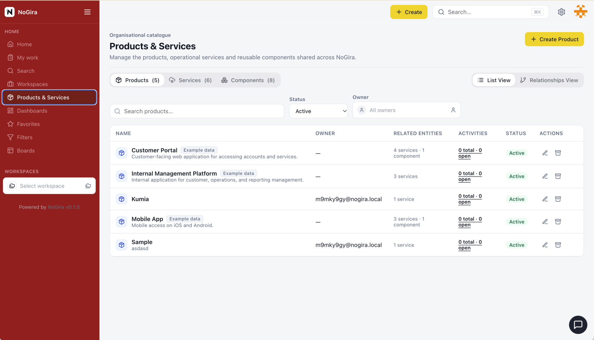

# NoGira 0.11.0

**Release date:** 2026-11-12

**Products, Services, Components & Versions** — plus small Create Sprint and mobile create/move/filter extras (**NGF-045**, **NGF-016**, **NGF-082**, **NG-759**, **NG-760**, **NG-726-P15–P17**).

## Screenshots

*Placeholder — operator will add the GIF at `docs/assets/nogira-catalogue.gif`.*

## Added

- Organisation-shared **Products / Services / Components / Versions** catalogue (`/home/products-services`), workspace attach, relationship graph, system managers + kind grants, starter sample seed, and Create Activity catalogue field selectors (**NG-759** / **NGF-045**).
- Create Activity **SprintFieldSelector** for SCRUM boards; backlog **Remove** deletes a PLANNED sprint; **Start** for planned vs active (**NG-760**).
- Mobile Search **RefreshCw** control and **pull-to-refresh** (**NG-726-P17**).

## Changed

- Mobile Create FAB uses primary ActionButton colors with Lucide + **Create** text (`Plus` activities, `FilePlus2` wiki) (**NG-726-P17**).
- Create / Move / Filter footers use shared **ActionButton**; Move keeps current workspace selectable and selected by default (**NG-726-P15**).
- Mobile category filters use **SegmentedTabs**; result count only on the active tab (**NG-726-P16**).
- Mobile drawer shows **InstanceBrand**; app bar title is `AppName • workspace` without logo; category icons muted gray (**NG-726-P15**).
- Version options render as `Product - Version` (**NG-759-P19**).

## Fixed

- Move from mobile swipe no longer hides the current workspace (same-workspace type change) (**NG-726-P15**).

## Upgrade notes

- Sample installer `docker-compose.yml` stays on **`latest`** (do not pin tags in the sample).
- Core applies Prisma migrations for catalogue foundation / hybrid entity / workspace component / starter seed / kind manager on startup — no manual SQL.
- Promote matching **core + ui + worker + mcp** images together.
