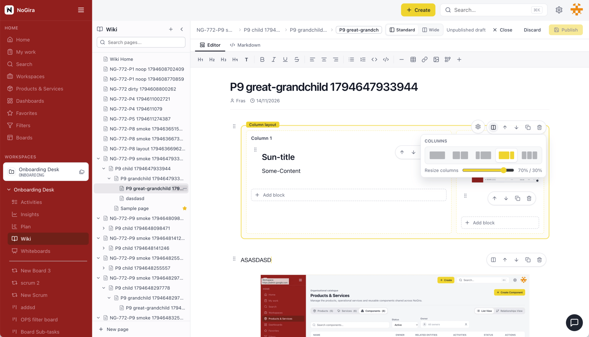

# NoGira 0.12.0

**Release date:** 2026-11-14

**Enterprise Wiki modular UI & composition** (**NGF-100**, **NG-772** P0–P5 + P7–P9). Modern view/edit shell, registry-driven insertion, Markdown layout columns, block reorder, modern tables, and editor polish. **P6** (responsive/a11y/perf + product e2e suite) remains open.

## Screenshots

*Placeholder — operator will add the GIF at `docs/assets/nogira-enterprise-wiki.gif`.*

## Added

- Wiki **Standard / Wide** page width preference (UI preference, not a DB column) (**NG-772-P2**).
- Shared **Component picker** for slash (`/`) and **Insert more**, with Lucide icons per insertion (**NG-772-P3** / **P8**).
- Versioned **`{{layout}}` Markdown macro** for 1/2/3-column composition with nested column editors (**NG-772-P4**).
- **Block drag/reorder** (`@dnd-kit`) plus keyboard move controls (**NG-772-P5**).
- **Modern table block editor**: header row/column, column/row grips, insert `+` lines, quick delete, Tab/Enter navigation (**NG-772-P8**).
- Editor interaction **performance baseline** harness under `nogira-testing/performance/wiki/` (**NG-772-P0**).

## Changed

- Wiki text blocks: **no grey surface / no padding jump**; blinking caret at the click point (**NG-772-P9**).
- Layout frame, badge, and dashed columns use **`--ng-primary`** (theme-aware) (**NG-772-P9**).
- **`{{child-pages}}`** honours configured **depth** (1–3), including grandchildren via lazy branch fetch; list / cards / gallery (**NG-772-P9**).
- Mermaid / GIF / primary-button editor chrome polished to match the sample (**NG-772-P7**).

## Fixed

- Animated **GIF** wiki attachments no longer flatten to a still WebP preview; preview/download keep animation (**NG-772-P7**).
- Typing in a **table cell** (and block delete/move) enables **Save** (**NG-772-P9**).
- Layout columns use full available width after 1→2 preset changes (**NG-772-P8**).
- Card-macro block controls no longer cover the child-pages view switcher (**NG-772-P9**).

## Upgrade notes

- Sample installer `docker-compose.yml` stays on **`latest`** (do not pin tags in the sample).
- No Prisma migration in this release — layout and table state stay in Markdown.
- Promote matching **core + ui + worker + mcp** images together (core includes GIF preview fix).
- Product e2e coverage for the modern editor remains planned under **NG-772-P6**.
