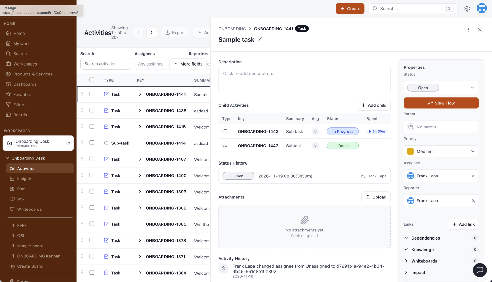

# NoGira 0.13.0

**Release date:** 2026-11-19

**Feature:** Activity time tracking, logging, rollups, My Time, and mobile Log/Edit sheets (**NGF-019** / **NGDEV-397** / **NGDEV-398** / **NGDEV-403** / **NGDEV-404**).

## Screenshots

*Log time, Worklogs edit/delete, Time & Estimate rollups, and My Time overview.*

## Added

- **Time & Estimate** on activity detail: spent / estimate, tracking modes (Auto / Manual / Rollup), progress and breakdown.
- Manual **Log Time** / **Edit time** (desktop dialogs; mobile bottom sheets).
- **Worklogs** list with Edit / Delete (icon + label).
- Automatic session time confirm on Done (where enabled).
- Workspace **Estimation Defaults** (working calendar–aware effort levels).
- **My Time** (`/account/time`) cross-workspace calendar / table + day worklogs.
- Live spent chips on boards / My Work (where shipped under **NGDEV-403**).
- Mobile: **+ Log time**, interactive spent/estimate, Worklogs actions; Action Sheet redundant Edit removed.

## Changed

- Mobile Time & Estimate is interactive (no longer read-only).
- Mobile Log Time omits the **Logged** column; sheet padding matches Comment sheets.

## Fixed

- Edit Time start time (`startMinute`) round-trip.
- iOS native `type=time` overflow eating sheet right padding.

## QA

- `activity-time-onboarding-rollup` · `workspace-estimation-defaults` · `activity-time-worklogs` (API) · `activity-time-mobile-log` · `my-time-account` — green on QA `:3013`/`:4013` (2026-11-19).

## Upgrade notes

- Sample installer `docker-compose.yml` stays on **`latest`**.
- Promote matching **core + ui + worker + mcp** images together (Prisma time-tracking migrations apply on core startup).
- After upgrade: open an ONBOARDING TASK → Time & Estimate → Log time; open **My Time** from the profile menu.
- User guide: [Time Tracking](../time-tracking.md).
