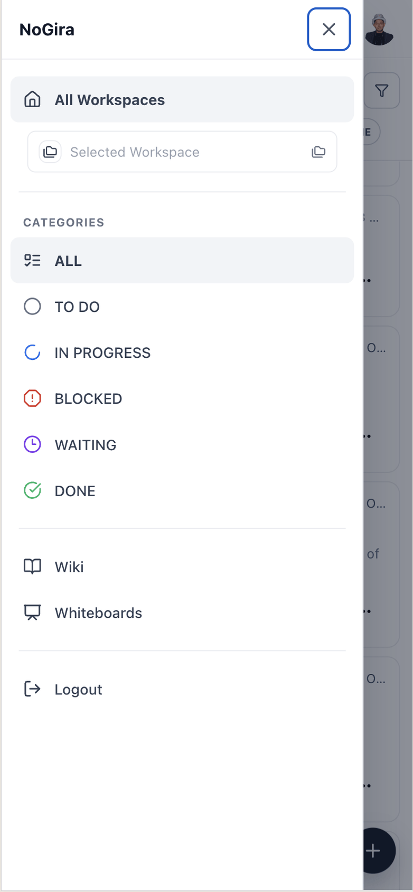

# NoGira 0.3.8

**Release date:** 2026-10-19

**NG-726 mobile web** (**NGF-082**) — a phone-width shell for activities, wiki, and whiteboards. Desktop layout stays the same.

**Tracking:** **NG-726**, **NG-726-P1**–**P9**, **NGF-082**.

## Screenshots

*GIF to be added.*

## Added

- **Mobile shell** below 768px: app bar, drawer, and page chrome. Login and `/` open `/home/search`.
- **Activity feed** with Last Activity order, long-press selection, swipe actions, and a full-screen activity page.
- **Wiki and whiteboard feeds** at `/home/wiki` and `/home/whiteboards`, filtered by the selected workspace.
- **Wiki reader** with one level of child pages, and a pen that opens the existing wiki editor when the page can be edited.
- **Read-only whiteboard viewer** on an opened board.

## Changed

- Activity actions use the same Edit, assignee, status, Clone, and Archive controls as desktop. The sheet closes after a status, an assignee, a successful clone, or a successful archive.
- Wiki text search and whiteboard browse use `GET /api/search/wiki` and `GET /api/search/whiteboard`. Visible workspaces are resolved before pagination.

## Fixed

- The leftover black Actions chip no longer stays on an activity card after swipe or `…`.
- The wiki Edit control is the summary pen, not a filled button.

## Upgrade notes

- Dev is the validation target for this candidate. The public installer tags in `docker-compose.yml` stay on the last published semver until `cicd-release.sh`.
- Core startup applies Prisma migration `20261019120000_ng726_activity_recency` (`Activity.lastActivityAt`, `Activity.lastActivityType`).
- Desktop default activity sort is unchanged.
