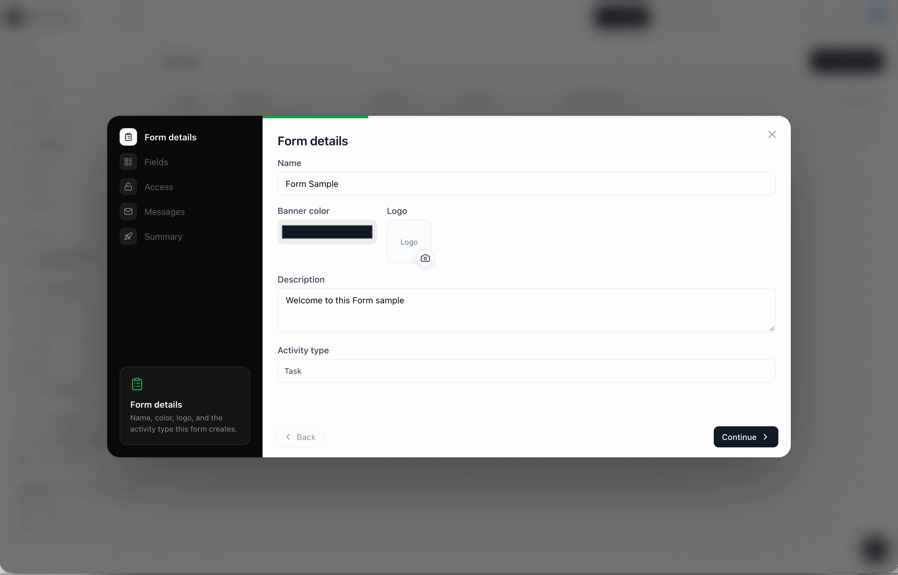

# NoGira 0.5.0

**Release date:** 2026-10-23

**Enabling Forms** (**NGF-083**) — a workspace publishes `/form/:code`, and a submission creates a real Activity. The same release stores the instance application name and sends sprint mail from the notification matrix.

**Tracking:** **NG-727**, **NG-727-P1**–**P11**, **NG-728**, **NGF-083**, **NGF-004**, **NGF-016**, **NGF-051**.

## Screenshots

*Add `nogira-forms.gif` under `docs/assets/` before publishing the installer tag. Show the workspace Forms list and system Forms, the five-step wizard (details, fields with the X and Summary kept, access, messages, summary), the public page with privacy acceptance, and the submitted screen.*

## Added

- Workspace **Forms**, in the left menu before Settings, and **Forms** under system settings.
- A five-step wizard: Form details, Fields, Access, Messages, Summary. Summary stays on the form. Other selected fields have an X that returns them to Available.
- Public page `/form/:code` for a signed-in visitor and, when the form is Public, for a visitor with no session. Opening the link does not grant workspace membership.
- Privacy acceptance on Public forms, a confirmation email to the submitted address, and optional registration for a System Admin.
- `InstanceSettings.applicationName` (default `NoGira`). The home sidebar, mobile bar, and settings shell show the instance logo, or the mark when no logo is stored, beside that name.

## Changed

- `/settings/system` saves the application name.
- Transactional email uses that name in the header, the footer, and product phrases. When a logo is stored, the header still shows the logo and the name. SMTP from name stays the mailbox display name.

## Fixed

- A repeated email, when repeats are off, shows the same success and creates no second Activity.
- Starting or completing a sprint emails the people enabled in the workspace notification matrix. Reporters and assignees are the distinct people still on that sprint, and the person who performed the action is left out. Adding or removing an activity stays silent until those matrix rows are turned on.
- A notification event the worker does not recognize is recorded and skipped. It no longer stops later mail, including a form confirmation.
- A form confirmation still sends when the activity link is missing. That mail has no View request button.

## Upgrade notes

- Dev and UAT stay on the last deployed tag until you promote this candidate. The public installer tags in `docker-compose.yml` stay on the last published semver until `cicd-release.sh`.
- Core startup applies Prisma migrations `20261022200000_ng727_enabling_forms`, `20261023120000_ng727_form_appearance`, and `20261023180000_ng728_application_name`.
- Existing instances keep the application name `NoGira` until an administrator saves a new name.
