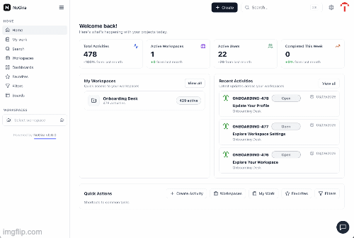

# NoGira 0.6.0

**Release date:** 2026-10-24

**Application version label** (**NGF-084**, **NG-730**) — the running version is visible on the expanded menu, the public form, the sign-in pages, the email footer, and `/api/health`.

**Tracking:** **NG-730**, **NGF-084**.

## Screenshots

*Add `nogira-version.gif` under `docs/assets/` before publishing the installer tag. Show the expanded left menu, the public form powered-by line, and a sign-in page. Each reads Powered by NoGira plus the version.*

## Added

- The expanded left menu and `/form/:code` show **Powered by NoGira vX.Y.Z**. The label comes from `REACT_APP_VERSION`.
- Login, register, reset password, and the other single sign-in pages show the same line under the form, with padding `16px 16px 32px`.
- The phone menu shows only **vX.Y.Z** under Logout. No extra divider is added.
- `GET /api/health` includes `version` from `APP_VERSION`.

## Changed

- The email title still uses the instance application name. The shared footer is **© year NoGira vX.Y.Z. All rights reserved.**

## Upgrade notes

- Dev and UAT stay on the last deployed tag until you promote this candidate. The public installer tags in `docker-compose.yml` stay as they are until `cicd-release.sh`.
- No Prisma migration. The product UI reads `REACT_APP_VERSION`. Core and the notification worker read `APP_VERSION`. An empty value omits the version.
