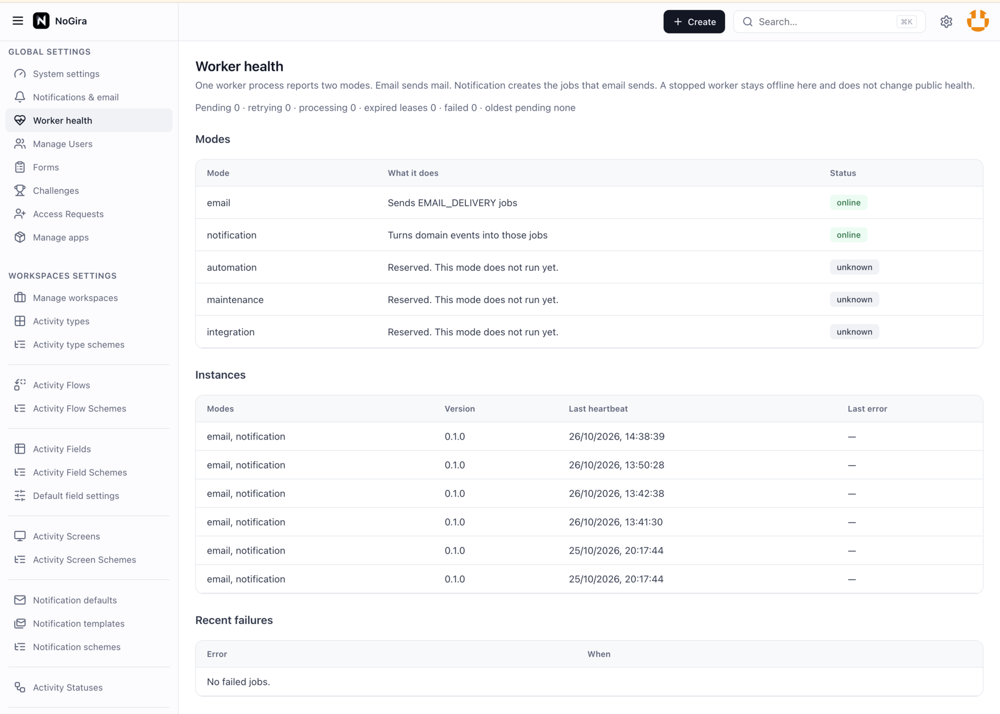

# NoGira 0.7.0

**Release date:** 2026-10-26

**Worker runtime** (**NGF-086**, **NG-733**) — the evaluation installer starts `nogira-worker` instead of `nogira-notification-worker`. One process reports email and notification health. System administrators see those modes in settings tables.

**Tracking:** **NG-733**, **NG-733-P1**, **NG-733-P2**, **NG-733-P3**, **NG-733-P4**, **NG-733-P5**, **NG-733-P6**, **NG-733-P7**, **NG-733-P8**, **NGB-064**, **NGF-086**.

## Screenshots

*System administrator view of email and notification health.*

## Added

- Settings page **Worker health** lists Modes, Instances, and Recent failures. `GET /api/system/worker-health` is for system administrators. `GET /api/health` stays up when the worker is down.
- Public compose service `nogira-worker`, container `ng-worker`, `WORKER_MODE=all`.
- Database login `nogira_worker`. Core sets the password from `NOGIRA_WORKER_DB_PASSWORD`.
- `NotificationJob` and `DomainEvent` claims use a lease. Only the current lease can finish the row.

## Changed

- Email mode sends `EMAIL_DELIVERY` jobs. Notification mode turns domain events into those jobs. `all` runs both in one process.
- Hosted deploy and the QA stack run `nogira-worker`. The old notification worker image stays only as a local rollback.

## Fixed

- The heartbeat uses its own database connection (**NGB-064**).
- QA core starts when `NOGIRA_WORKER_DB_PASSWORD` is letters and digits (**NG-733-P8**).

## Upgrade notes

- Dev and UAT stay on the last deployed tag until you promote this candidate. The public installer tags in `docker-compose.yml` stay as they are until `cicd-release.sh`.
- Set an alphanumeric `NOGIRA_WORKER_DB_PASSWORD` in `.env` before `docker compose up -d`.
- Replace the `nogira-notification-worker` service with `nogira-worker`. Remove the old container if it is still running: `docker rm -f ng-notification-worker`.
- Core applies the worker migrations on startup and sets the `nogira_worker` password. No manual SQL.
- Pin `nogira-core`, `nogira-ui`, `nogira-worker`, and `nogira-mcp` to **0.7.0** together when the Hub tags exist.
