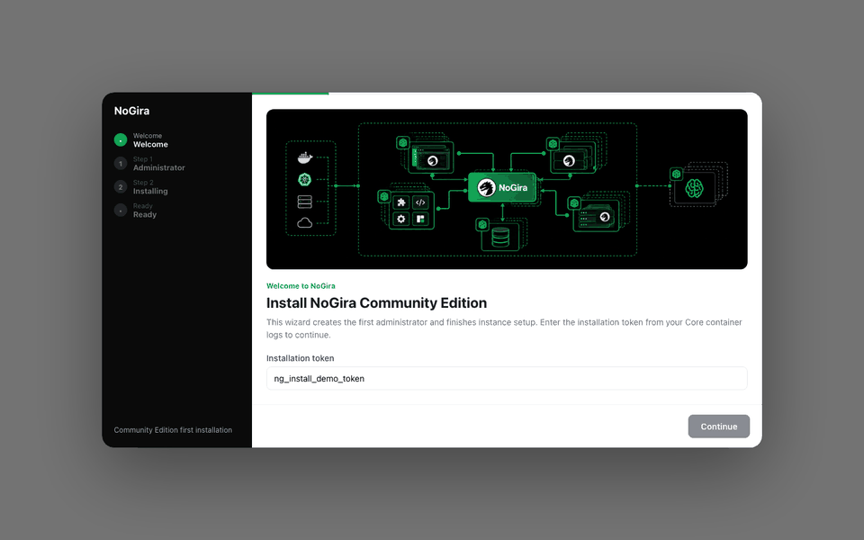
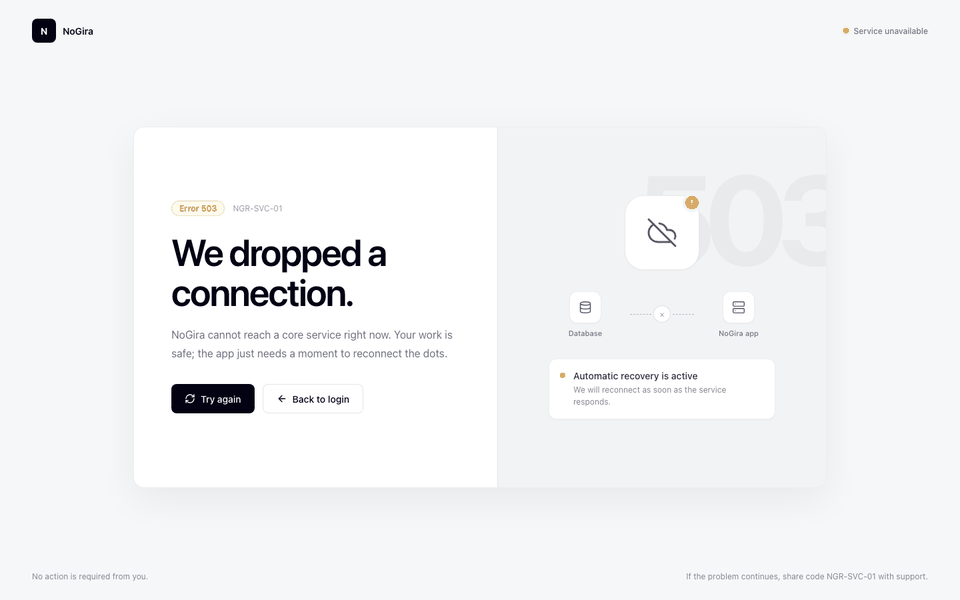
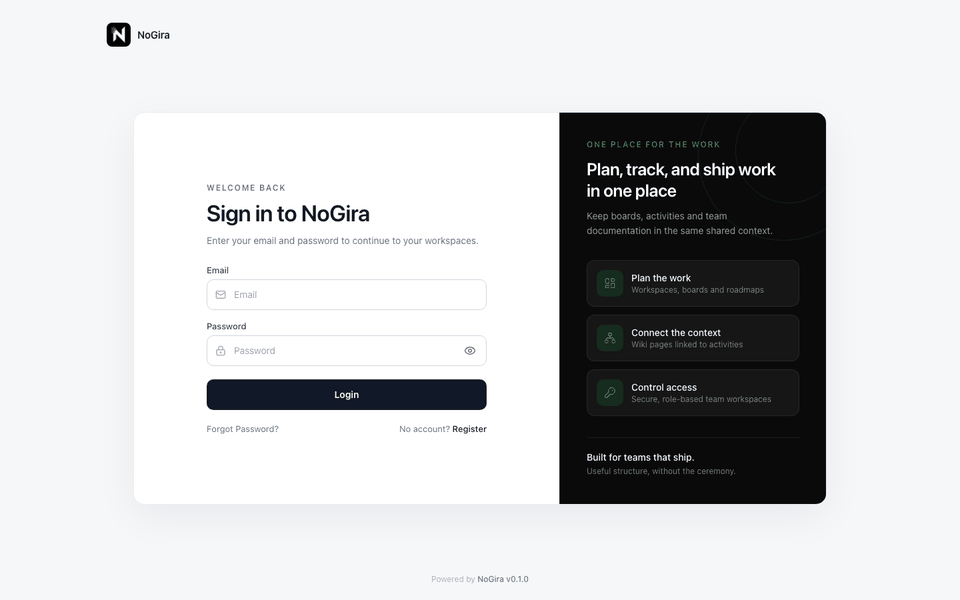

# NoGira 0.8.0

**Release date:** 2026-10-28

**First installation, availability, and authentication UI** (**NGF-011**, **NGF-012**, **NGF-084**, **NG-734**) — Community Edition first-run uses a 24h install token, a modal install wizard with branded banners, async Core-owned progress, and clear Core-down vs database-down Error 503 screens. Activity creation uses an atomic per-workspace key counter. Public authentication pages share a responsive branded shell while preserving their existing fields and links.

**Tracking:** **NG-734**, **NG-734-P1–P12**, **NG-734-B1**, **NG-734-P14**, **NGB-066–070**, **NGF-011**, **NGF-012**, **NGF-084**. **NG-734-P15 is a draft follow-up and is not included in 0.8.0.**

## First installation wizard

*Install modal from the one-time token through administrator credentials, live Core-owned progress, and Log in to NoGira.*

## Service unavailable

*Separate Error 503 states for an unreachable Core service and an initialized instance whose PostgreSQL database is unavailable.*

## Authentication

*Login, account request, and password recovery use the shared responsive shell with instance branding and the NoGira onboarding black, white, and green theme.*

## Added

- **Install bootstrap token** — Core mints a 24h hashed token under `/data/config`, prints the plaintext once to Core logs, and supports regenerate via `install-bootstrap-token` CLI (alongside `emergency-admin` for post-init recovery).
- **Install wizard modal** — Step 0 Welcome + token → Step 1 administrator credentials → Step 2 backend `operations[]` progress → complete with **Log in to NoGira** (no auto-login).
- **Setup session** — `POST /api/setup/authorize` returns a short-lived setup session; progress detail requires the session; visitors without a session see a configuring message while install runs.
- **Async cold bootstrap** — admin create starts Core-owned background install and returns **202**; closing the browser does not cancel work; authorised clients can resume progress.
- **Branded Error 503 screens** — Core unreachable and post-init database unavailable use the shared service-unavailable layout (**Error 503**, support codes `NGR-SVC-01` / `NGR-DB-01`).
- **Final wizard banners** — flat black/green artwork for Welcome, Credentials, Progress, and Complete under `/install/nogira-install-*-1.jpg`.
- **Atomic activity keys** — `WorkspaceActivityCounter` reserves each workspace’s next key in the same transaction as activity creation across HTTP, MCP, forms, and onboarding paths.
- **Shared authentication shell** — `/login`, `/register`, `/access-request`, `/forgot-password`, and `/reset-password/:token` share one responsive layout with visible labels, icons, instance logo/application name, version footer, and black/white/green desktop panel.

## Changed

- **SetupGate availability routing** — transport failure is never treated as “Connect database”; initialized instances with a down database show the DB unavailable screen instead of reopening the install wizard.
- **Instance initialized marker** — successful setup writes a durable on-disk marker so Core can classify DB outages after init.
- **Authentication presentation** — titles and descriptions are clearer; all existing field inputs, validation, submit behavior, and internal links are preserved.
- **Activity creation path** — root, child, MCP, form, and onboarding creates use the shared transactional allocator. P11/P12 performance experiments were measured and the P9 allocator remains the production default.

## Fixed

- **NGB-066** — First-install bootstrap and Core/DB availability confusion for CE installs.
- **NGB-067** — First-admin email is required and validated (UI + Core).
- **NGB-068** — Stopping PostgreSQL after a successful install no longer reopens the install wizard; Core-down and DB-down show branded Error 503.
- **NGB-069** — Existing Onboarding Desk workspaces missing a counter are repaired from the highest matching activity-key suffix; new workspaces create the counter eagerly.
- **NGB-070** — Installation banner images render at their intended 3:1 aspect ratio.

## Upgrade notes

- Dev and UAT stay on the last deployed tag until you promote this candidate. The public installer tags in `docker-compose.yml` stay as they are until `cicd-release.sh --version 0.8.0`.
- Pin `nogira-core`, `nogira-ui`, `nogira-worker`, and `nogira-mcp` to **0.8.0** together when the Hub tags exist, then `docker compose pull && docker compose up -d`.
- Fresh CE compose with `DATABASE_URL` set skips the self-serve DB step; ensure `/data` is persisted so the install token and initialized marker survive restarts.
- No manual SQL for NoGira schema migrations (applied on core startup).
- PostgreSQL remains pinned at `postgres:14` — do not change major version without a PostgreSQL migration procedure ([deployment.md](../deployment.md)).
