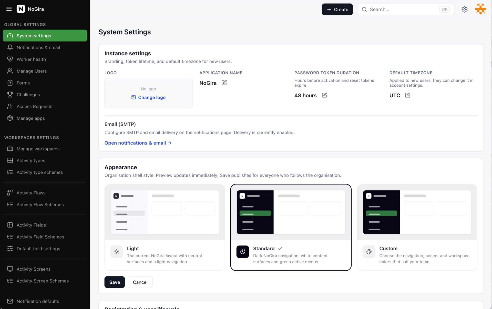

# NoGira 0.9.0

**Release date:** 2026-11-10

**System appearance & look-and-feel** (**NGF-093**, **NGF-094** foundation, **NG-756**) — Organisation Light / Standard / Custom shell themes with ModeCards, contrast-safe Custom colours (including primary button tokens), personal Configure layout under Account, mobile drawer/app-bar title contrast, primary CTA / checkbox / modal parity, in-app notice modals (no browser `alert`/`confirm`), and theme-aware brand logo packs. Email notification logos use shared CID branding after the Core/worker split. QA e2e covers ModeCard look-and-feel changes.

**Tracking:** **NG-756** P0–P4 + PX–**PX11**, **NGF-093**, **NGF-094**.

## Desktop layout transition

*Desktop layout: Light shell ↔ Standard dark navigation (2s per frame).*

## Added

- **Org Appearance ModeCards** — Settings → System → Appearance uses Light / Standard / Custom preview cards (no tabs); Custom panel includes sidebar, active menu, page background, density, and **Primary button** / **Primary button text** (**NG-756-P1**, **PX4**, **PX5**).
- **Configure layout** — Personal `/account/configure-layout` (ModeCards + Custom style panel); Account Appearance **Follow enterprise** / **Custom** with **Customize** CTA; entry from profile avatar menu (not Home sidebar); prefs `layout.configure` + `appearance.mode=CUSTOM` (**NG-756-P2**, **PX2**, **PX3**, **PX11**).
- **Primary tokens** — `--ng-primary` / `--ng-primary-fg` drive `ActionButton` black and Appearance Save; persisted as `appearanceCustomPrimary*` (**PX5**, **PX8**).
- **Contrast formula** — Sidebar/title fg: light keeps `#111827`, dark uses white, mid Custom uses RGB invert with 4.5:1 fallback (`visibleFgOnBackground`) (**PX5**, **PX6**).
- **Notice / confirm modals** — Shared `showNotice` / `showConfirm` host replaces browser `alert` / `confirm` across settings, boards, flows, wiki, activities; Instance logo **Remove logo** uses danger confirm (**PX9**).
- **Theme-aware brand marks** — Light shell uses black `*-light.png` pack; Standard / personal Dark / dark Custom sidebar uses white default pack (favicon + sidebar `NogiraBrandMark`) (**PX10**).
- **Email CID branding** — Shared `@nogira/email-branding` vendor sync into Core/worker Docker context; atomic CID logo attachments on notification mail (**P3**).
- **Appearance e2e** — `nogira-testing` `appearance-look-feel.spec.ts` (SYSTEM_ADMIN org ModeCards + owner Configure layout) on the QA stack (**PX7**).

## Changed

- **Topbar / MobileAppBar** — Header uses `--ng-shell-header` / `--ng-shell-header-fg` (wash gray vs dark sidebar); mobile app bar no longer falls back to content `--ng-fg` (**PX**, **PX5**).
- **Mobile nav drawer** — ResponsiveSheet title/close inherit panel `--ng-shell-fg` so dark sidebars stay readable (**PX6**).
- **InstanceBrand** — Inherits parent colour (sidebar / header) instead of hardcoded black (**PX6**).
- **Checkboxes & settings CTAs** — Matrix / settings list checkboxes and modal submit / Create Workspace / Reindex primaries follow `--ng-primary` (**PX8**).
- **Onboarding / challenge accents** — Wizard and challenge chrome aligned with appearance primary / green tokens where applicable (**PX8**).
- **Configure layout entry** — Moved from Home sidebar `/home/configure-layout` to Account + profile menu; old path redirects (**PX11**).

## Fixed

- Dark Custom sidebar with black preferred text left titles unreadable on desktop and mobile — auto-invert + inherit shell tokens (**NG-756-PX5/PX6**).
- User navigate header matched sidebar (transparent Topbar over sidebar paint) — header token parity with admin (**NG-756-PX5**).
- Instance logo **Remove logo** opened the browser confirm alarm — replaced with standard warning/danger modal (**PX9**).
- White brand mark invisible on Light wash / black mark invisible on Standard dark nav — pack switch via `data-brand-logo` (**PX10**).
- Notification emails missing instance logo after worker image split — CID bundle + vendor sync in handbook CI (**P3**).

## Upgrade notes

- Sample installer `docker-compose.yml` stays on **`latest`** (do not pin tags in the sample).
- Promote candidate images together (core, ui, worker, mcp). Schema adds appearance columns via Prisma migrate on core start (`instance_appearance`, `appearance_custom_extended`, `appearance_custom_primary`).
- After upgrade, SYSTEM_ADMIN can set Appearance under `/settings/system`; users can personalise via **Account → Appearance → Custom → Customize** (`/account/configure-layout`) or the profile avatar **Configure layout** item.
- No manual SQL. PostgreSQL remains `postgres:14`.
