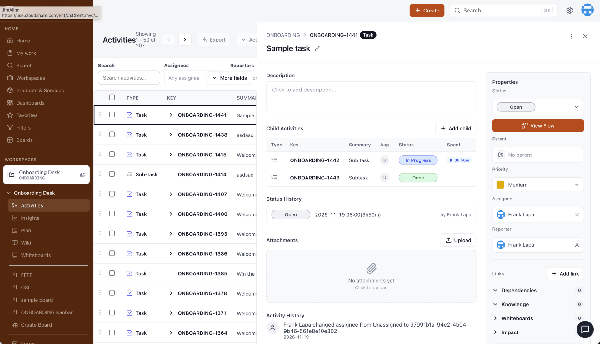

# NoGira Time Tracking & Effort Estimation

Estimate how much work an activity should take, capture time as people progress work, log time by hand when needed, confirm automatic suggestions, and review your own work across workspaces in **My Time**.

Time tracking and effort estimation are related but separate:

| Concept | What it means |
|---------|----------------|
| **Effort estimate** | Expected work for the activity (manual value or rollup from children). |
| **Confirmed time** | Worklogs that count in **Total Spent** (manual logs and confirmed automatic suggestions). |
| **Pending / Time to confirm** | Automatic session time waiting for review — not yet part of Total Spent. |

NoGira does **not** require a continuous start/stop stopwatch. Automatic tracking follows **activity status**: when work moves into **In Progress**, a session starts; when it leaves that status, the session ends and suggested hours are calculated from the instance **Working Calendar**.

Shipped in installer **[0.13.0](releases/0.13.0.md)**.

## Screenshots



*Activity Time & Estimate, Log Time / Worklogs, confirmation of pending automatic time, and the My Time account overview.*

---

## How Time Tracking Works

### Lifecycle (simple example)

1. You open a Story and move it to **In Progress**.
2. NoGira records when that session started (UTC timestamps).
3. You do the work — you can close the browser; the session stays open while the activity remains In Progress.
4. You move the Story to **Done** (or any non–In Progress status). The automatic session stops.
5. NoGira calculates suggested time by intersecting the session with **working days and hours** (and holidays) from **Settings → Working Calendar**.
6. You review **Date** and **Spent** suggestions, adjust if needed, then **Confirm** — or choose **No time needed**.
7. Confirmed minutes become worklogs and increase **Total Spent**. Pending time disappears until a new unreviewed session segment exists.

Automatic tracking is **status-based**, not a timer you must click every day.

### Automatic time

| Topic | Behaviour |
|-------|-----------|
| Starts | Activity enters **In Progress** and tracking mode is **Automatic**. |
| Stops | Activity leaves **In Progress** (Blocked, Waiting, Done, Todo, etc.). |
| Multiple sessions | Re-entering In Progress starts a **new** session. |
| Long-running | Sessions do not auto-stop. Very long open sessions may show a long-running cue on cards; review from Time & Estimate. |
| Archive | Archiving closes an open automatic session; pending suggestions can remain until reviewed. |

### Pending time (Time to confirm)

Pending time is calculated from open or closed sessions that have not been fully reviewed yet. It appears as **Time to confirm** on the activity. It does **not** count in **Total Spent** until you confirm (or explicitly discard with **No time needed** for that review).

### Confirmed time

After **Confirm**, each day with minutes &gt; 0 becomes a worklog. Totals and hierarchy rollups update. Editing or deleting a confirmed worklog adjusts totals but does **not** recreate the old pending suggestion for that reviewed period.

### Manual time

Use **Log Time** anytime (subject to tracking mode and permissions). Manual entries coexist with automatic suggestions — NoGira does **not** subtract manual logs from pending automatic suggestions. You may create **multiple worklogs on the same date**.

---

## Quick Start — Track Your First Activity

1. Open an activity (for example a Task or Story).
2. Find **Time & Estimate** (between System Dates and Planning Dates on desktop detail).
3. Optionally set an **Estimated** duration (e.g. `8h` or `1d`) if the activity uses **Manual** estimation.
4. Move the activity to **In Progress** if you want automatic tracking.
5. Do the work.
6. Move it to **Done** (or another status). If automatic time is pending, the **Log Time Spent** review appears (especially on Done).
7. Adjust **Spent** values if needed → **Confirm**, or **No time needed**.
8. Check **Total Spent** on Time & Estimate.
9. Scroll to **Worklogs** (below Comments) to see confirmed entries.
10. Open your profile menu → **My Time** to see personal time across workspaces.

**Worked example:** Maria moves `NGDEV-42` to In Progress on Tuesday 09:00 and to Done on Tuesday 13:00. With an 08:00–16:00 working day, NoGira suggests about **4h**. She confirms. Total Spent shows `4h`; Worklogs lists one entry for that date.

---

## Understanding Time & Estimate

| UI element | Meaning |
|------------|---------|
| **Total Spent** | Confirmed time on this activity **plus** eligible descendants (not double-counted). |
| **Estimated** | Effective estimate: manual minutes, or rollup of children’s effective estimates. |
| **Progress** | Spent vs estimate (under / at / over). If there is no estimate, progress is not shown as a percentage of a budget. |
| **Current activity** | Confirmed time logged **directly** on this activity. |
| **Sub-elements** | Confirmed time on eligible children and deeper descendants (hidden on true leaf levels where there are no sub-elements). |
| **Time to confirm** | Pending automatic minutes; **Review** opens the confirmation UI. |
| Mode line | e.g. `Automatic tracking · Manual estimation`. |

Pending time is shown separately so teams do not treat unreviewed suggestions as final.

---

## Setting and Understanding Effort Estimates

### Manual vs Rollup

| Mode | Behaviour |
|------|-----------|
| **Manual** | You (or the workspace default) set the estimate. That value is the activity’s **budget boundary** — children’s estimates are **not** added on top of it. |
| **Rollup** | Effective estimate is the sum of children’s **effective** estimates (each child counted once, recursively). |

**Numerical example (manual boundary):** Feature A is Manual `40h`. Its Stories total `24h` of estimates. Feature A still shows **40h**, not 64h. Epic in Rollup that has Feature A (40h) and Feature B (24h rollup) shows **64h**.

Actual confirmed time always rolls up as direct + eligible descendants, **independent** of Manual/Rollup estimation mode.

### Duration formatting

Enter durations as `d` / `h` / `m` (for example `1d`, `4h`, `1.5h`, `30m`, or `1d 2h`). A bare integer is treated as minutes. Day length follows the Working Calendar **daily working hours** (default 8h). Display uses at most two units (e.g. `1d 4h`, `3h 10m`).

### Workspace defaults vs overrides

New activities inherit estimation mode / default effort / tracking mode from **Workspace Settings → Estimation Defaults** by hierarchy level. Changing defaults later does **not** rewrite existing activities. Each activity can still switch Manual/Rollup and tracking mode from the pencil on Time & Estimate (desktop).

---

## Configuring Default Effort Estimates

**Who:** Workspace Owner, Manager, or other roles that can edit workspace settings (same gates as other workspace configuration).

**Where:** Open the workspace → **Settings** → section **Estimation Defaults**.

| Control | Purpose |
|---------|---------|
| **Defaults / Custom** | Use the system template for this workspace type, or customise per hierarchy level. |
| Per-level **Estimation** | Manual or Rollup. |
| **Default estimated effort** | For Manual levels (e.g. `8h`). Rollup levels show Calculated. |
| **Tracking** (with estimation rows) | Seeds **Automatic / Manual-only / Rollup-only** for new activities at that level. |

Saving custom defaults warns that **existing** activities keep their current modes.

### Development workspace (typical template)

Hierarchy levels come from the Activity Type Scheme (numbers are scheme levels; **0** is the lowest / leaf).

| Level (typical types) | Estimation | Default effort | Tracking |
|-----------------------|------------|----------------|----------|
| Leaf (e.g. Sub-task, Agent Task) | Manual | Not set | Automatic |
| Mid (e.g. Story, Task, Bug) | Manual | **8h** (one working day) | Automatic |
| Higher (e.g. Feature) | Rollup | Calculated | Rollup-only |

Exact type names depend on your scheme assignments.

### Portfolio workspace

Portfolio (and SAFe / Waterfall portfolio templates): levels default to **Rollup** estimation and **Rollup-only** tracking. Direct **Log Time** on those activities is still allowed.

### Custom workspace

Configurable hierarchy levels use the same Estimation Defaults UI — set Manual/Rollup, effort, and tracking per level.

---

## Configuring Automatic Time Tracking

| Tracking mode | Automatic sessions | Manual Log Time |
|---------------|--------------------|-----------------|
| **Automatic** (`Auto`) | Yes, on In Progress | Yes |
| **Manual-only** (`Manual`) | No | Yes |
| **Rollup-only** (`Rollup`) | No | Yes (direct logs still allowed) |

Defaults are set per hierarchy level in Estimation Defaults; override per activity from Time & Estimate → pencil → **Tracking** (desktop). Changing workspace defaults does not force-update existing activities.

---

## Configuring the Working Calendar

**Where:** **Settings → Working Calendar** (`/settings/working-calendar`).

**Who can edit:** **System Administrators** only. Others may see a read-only view.

**Timezone:** Configured in **System settings** (instance IANA timezone). Working hours are interpreted in that timezone. Stored session timestamps remain UTC.

| Setting | Effect |
|---------|--------|
| **Working days** | Days that count toward automatic suggestions. |
| **Daily working hours** | Length of a working day (also used for `1d` formatting). |
| **Working hours window** | Start/end of the working day for intersection with sessions. |
| **Holidays / non-working dates** | Excluded from automatic suggestions. |

**Why suggestions ≠ wall-clock:** A session from Monday 10:00 to Friday 11:00 with hours 08:00–16:00 might suggest about **6 + 8 + 8 + 8 + 3** hours across those days — not the full elapsed clock time, and not weekend hours if weekends are non-working.

**Holidays:** Days marked non-working contribute **0** automatic minutes.

**Calendar changes:** Confirmed worklogs are not recalculated. Pending suggestions for historical dates use the calendar rules applicable to those periods as implemented (effective calendar versions). Future pending calculations use the current calendar.

---

## How to Log Time Manually

### Desktop

1. Open the activity → **Worklogs** → **Log Time**, or use flows that open the same **Log Time** modal.
2. Optionally change **Author** if you are a manager/owner/admin (members can only log for themselves).
3. Choose **From** / **To** dates (single-month range picker with previous/next month, Apply/Clear).
4. Enter **Spent** on each day row you want (leave blank to skip a day).
5. Optionally enable **Include non-working days**.
6. Save with **Log Time**.
7. Confirm the new cards under Worklogs and updated Total Spent.

**Limits:** Each individual entry is **1–1440 minutes** (24 hours). Multiple entries on the same day are allowed; there is no cumulative daily cap across activities.

### Multi-day example

From Monday to Wednesday, enter `2h`, leave Tuesday blank, enter `3h` on Wednesday → two worklogs created. Non-working days appear only if you include them.

---

## How to Confirm Automatically Tracked Time

1. Pending appears as **Time to confirm** with a **Review** action, and/or the **Log Time Spent** modal on Done.
2. Each row shows **Date** and editable **Spent**.
3. Edit values as needed (same duration rules; max 24h per day row).
4. **Confirm** saves positive days as worklogs.
5. **No time needed** checkpoints the review with no logged minutes for that suggestion set.
6. Closing without confirming (where dismiss cancels) leaves pending for later.
7. You can review while still **In Progress** — confirmation can checkpoint reviewed periods and keep the session open when that path is used.
8. Moving to Done typically surfaces the review if pending remains.

Overlapping sessions or reassignment can show subtle warnings; Author defaults toward the current assignee when confirming automatic time.

---

## Viewing, Editing and Deleting Worklogs

**Where:** Activity detail → **Worklogs** (below Comments).

| Behaviour | Detail |
|-----------|--------|
| List | Newest **3** cards first; **Load 10 more** repeatedly. |
| Fields | Author, date, duration. |
| Edit / Delete | Own entries for members; managers/owners/admins for others in scope. |
| After change | Totals refresh; previously reviewed automatic periods are **not** reopened as pending. |

Editing a worklog is not the same as reviewing pending automatic time. Deleting a worklog does not delete the activity. Soft-deleted / archived activities are excluded from **current** ancestor rollups while retained for history as implemented.

---

## Using Time Tracking on Mobile

Available from installer **0.13.0** (mobile log/edit is implemented — older planning notes that said “mobile read-only” are superseded).

| Surface | Behaviour |
|---------|-----------|
| **Time & Estimate** | Interactive totals; tap spent/estimate as implemented; **+ Log time** button. |
| **Log Time / Edit time** | **Modal Bottom Sheet** (bottom sheet) — same fields as desktop Log/Edit, mobile layout (**Date \| Time \| Spent**; no **Logged** column on the sheet). |
| **Worklogs** | View cards; **Edit** / **Delete** with confirmation. |
| **Activity Action Sheet** | Activity actions only — **not** the time-entry form. Redundant Edit for time was removed from that sheet. |

Desktop keeps dialogs (`ModalShell`); mobile uses the bottom sheet for add/edit time.

---

## How Time Rolls Up Through Activities

Example:

```text
Feature (1h direct)
 └── Story (0 direct)
      ├── Sub-task A (1h)
      └── Sub-task B (1h)
```

| Activity | Current activity | Sub-elements | Total Spent |
|----------|------------------|--------------|-------------|
| Sub-task A | 1h | — | 1h |
| Story | 0 | 2h | 2h |
| Feature | 1h | 2h | **3h** |

Child hours are not counted twice. Manual worklogs on a parent add to that parent’s direct time. Reparenting moves the activity’s contribution to the new ancestor path. Archived parents exclude their subtree from **current** ancestor totals; restoring can bring eligible time back into rollups. Soft-deleted activities are excluded from current rollups; linked worklogs are preserved for audit/history.

---

## Understanding Live Time Indicators

Compact chips appear on **Kanban / Scrum boards**, **My Work**, and related activity lists.

| Display | Meaning |
|---------|---------|
| Clock + duration | Confirmed spent (direct + children as supplied by the card). |
| Play + blue tint | Activity In Progress with a **live** open session — display can include minutes since session start (not yet confirmed). |
| Orange / long-running cue | Session flagged as long-running — review time. |

Live extras are **not** confirmed worklogs until reviewed. When the activity leaves In Progress, the live tick stops and pending/confirmation flows apply.

---

## My Time — Your Personal Time Overview

### What it is

**My Time** is your personal overview of confirmed worklogs across workspaces — calendar and table views of the same underlying time records as activity Worklogs.

### Opening My Time

Profile menu (top bar) → **My Time** → `/account/time`.

### Calendar and table

| Capability | Notes |
|------------|-------|
| Period | Week / month style navigation via the toolbar. |
| Views | Calendar and **table** (timesheet-style). |
| Workspace filter | Optional workspace scope (all vs one workspace). |
| Day interaction | Open day worklogs; edit/log where permitted. |
| Log Time | Can open Log Time for a remembered / selected activity. |

### Example

You log 3h on a Story in Workspace A and 2h on a Bug in Workspace B the same week. My Time shows both entries in the selected range; activity Worklogs in each workspace show only that workspace’s activity entries. They are the **same** worklogs, different views.

---

## Who Can Log and Manage Time?

| Action | Member | Workspace Manager / Owner | Instance Admin / System Admin |
|--------|--------|---------------------------|-------------------------------|
| Log own time | Yes | Yes | Yes |
| Change Author / log for others | No | Yes (workspace scope) | Yes |
| Edit / delete own worklogs | Yes | Yes | Yes |
| Edit / delete others’ worklogs | No | Yes | Yes |
| Estimation Defaults | Per workspace settings permission | Typically yes for Owner/Manager | Yes |
| Working Calendar | Read-only (usually) | Read-only | **System Admin** edits |

Exact workspace role names used by the API include `WORKSPACE_OWNER`, `WORKSPACE_MANAGER`, `INSTANCE_ADMIN`, `INSTANCE_SYSTEM_ADMIN`.

---

## Practical Examples

1. **Automatic Story** — Move to In Progress → Done → confirm suggested hours → Total Spent updates.
2. **Manual log** — Log Time `2h` without using In Progress → worklog appears; pending unchanged.
3. **Manager for another user** — Manager sets Author to a teammate and logs `1h`.
4. **Story with Sub-tasks** — Time on Sub-tasks appears under Story **Sub-elements**.
5. **Feature Rollup estimate** — Feature shows sum of child effective estimates; Manual Feature stays on its own budget.
6. **Over estimate** — Spent exceeds Estimated → overrun styling on Time & Estimate.
7. **Forgot to confirm** — Time to confirm remains; Total Spent unchanged until Review.
8. **Wrong worklog** — Edit duration or Delete; totals adjust; old pending does not return.
9. **Weekend span** — Automatic suggestion skips non-working days unless your calendar marks them working.
10. **My Time across workspaces** — Filter or view all; both workspaces’ entries appear in range.

---

## Frequently Asked Questions

**Does NoGira automatically track my time?**  
Only when the activity’s tracking mode is **Automatic** and the status is **In Progress**.

**Do I need to start a timer?**  
No. Status changes drive sessions.

**Does time continue when I close the browser?**  
Yes for open In Progress sessions — timing is server-side from status timestamps.

**What if an activity stays In Progress overnight?**  
The session stays open; suggestions use working hours across days when you review.

**Do weekends / holidays count?**  
Only if they are working days on the Working Calendar (holidays are excluded).

**Can I log time manually?**  
Yes, via Log Time (including on Rollup-only activities).

**Can I log against a Feature?**  
Yes — direct manual logs are allowed at all levels.

**Multiple entries same day?**  
Yes.

**Why is pending different from Total Spent?**  
Pending is unreviewed automatic time.

**Can I edit confirmed time?**  
Yes, via Edit on the worklog (with permission).

**Archive / delete activity?**  
Archive/soft-delete exclude from current rollups; worklogs are retained for history as implemented.

**Where do I see all my time?**  
**My Time** (`/account/time`).

**Mobile?**  
Yes — Log time, edit/delete worklogs via Modal Bottom Sheet (0.13.0+).

---

## Troubleshooting

| Symptom | Likely cause | What to check | Action |
|---------|--------------|---------------|--------|
| Automatic tracking did not start | Mode not Automatic / never In Progress | Time & Estimate mode line; status | Set Tracking to Auto; move to In Progress |
| No Time to confirm | Nothing pending or already reviewed | Recent status exits; Worklogs | Complete a session or Log Time manually |
| Suggested time too low | Working hours / holidays | Working Calendar; session times | Adjust calendar or edit Spent before Confirm |
| Suggested time too high | Long open session / calendar window | Long-running cue; calendar | Edit Spent or No time needed |
| Weekends excluded | Non-working days | Working days list | Expected, or mark days working |
| Cannot change Author | Member role | Your workspace role | Ask a manager/owner |
| Cannot edit others’ worklogs | Permission | Role | Manager/owner/admin required |
| Parent totals look wrong | Archive / rollup rules | Child archive state; direct vs sub-elements | Review hierarchy and archive |
| Estimated “Not set” | Manual unset or incomplete rollup | Estimate mode; children | Set Manual estimate or add child estimates |
| Missing in My Time | Outside date range / filter | Period and workspace filter | Widen range; clear filter |
| Mobile Log Time missing | Older images | Installer version | Upgrade to **0.13.0+** |
| UI not refreshing | Stale panel | Refresh activity / My Time | Reopen or refresh |
| Duration rejected | &gt; 24h in one entry | Spent field | Split across entries/days |

---

## Administrator Setup Checklist

- [ ] Set instance **timezone** (System settings).
- [ ] Configure **Working Calendar** (days, daily hours, window, holidays).
- [ ] Review each workspace **hierarchy** (Activity Type Scheme).
- [ ] Set **Estimation Defaults** (Manual/Rollup, default effort, tracking per level).
- [ ] Confirm Owner/Manager access to workspace settings; System Admin for calendar.
- [ ] Test: Automatic In Progress → Done → Confirm.
- [ ] Test: Manual Log Time and Worklogs edit/delete.
- [ ] Test: Parent Total Spent includes child worklogs.
- [ ] Test: **My Time** shows cross-workspace entries.
- [ ] Brief users: pending vs confirmed; how to open My Time.

**Global:** timezone, Working Calendar. **Per workspace:** Estimation Defaults and activity overrides.

---

## Quick Reference

### Automatic tracking vs status

| Status category | Automatic session |
|-----------------|-------------------|
| In Progress | Running (if Automatic mode) |
| Any other | Session closed / not running |

### Estimation

| Mode | Effective estimate |
|------|--------------------|
| Manual | Activity’s own minutes (boundary) |
| Rollup | Sum of children effective estimates |

### Tracking modes

Auto · Manual-only · Rollup-only (manual log always available).

### Pending vs confirmed

Pending = Time to confirm. Confirmed = Worklogs → Total Spent.

### Duration

`1d`, `8h`, `30m`, `1d 2h`; integer = minutes; max **1440** per entry.

### Desktop vs mobile

| | Desktop | Mobile |
|--|---------|--------|
| Settings pencil | Yes | Hidden (use defaults / desktop for mode edits) |
| Log / Edit | Modal | Modal Bottom Sheet |
| Worklogs Edit/Delete | Yes | Yes |

---

## Related Documentation

| Guide | Topic |
|-------|--------|
| [Release 0.13.0](releases/0.13.0.md) | Time tracking release notes |
| [Quick start](quick-start.md) | First install |
| [Wiki guide](wiki.md) | Documentation pages in-product |
| [Deployment](deployment.md) | Upgrades and volumes |
| [FAQ](faq.md) | Installer / editions |
| [README](../README.md) | Product overview (includes Time Tracking section) |

---

*Installer documentation for the public NoGira evaluation images. Behaviour described here matches the shipped **0.13.0** product surfaces.*
